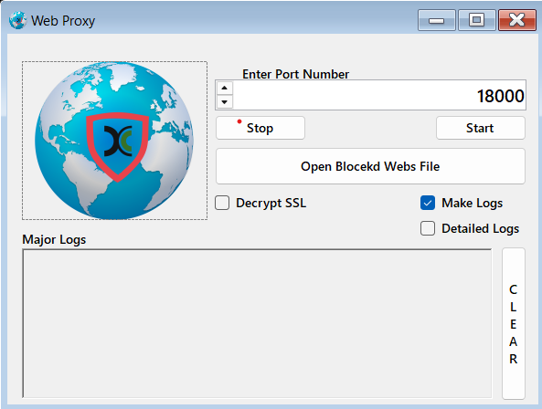

# HTTP Proxy Server

This is a simple HTTP proxy server application built with C# and WinForms. It uses the Titanium.Web.Proxy library to intercept and log HTTP/S traffic.

## Features

*   **Start/Stop Proxy:** Easily start and stop the proxy server.
*   **Port Configuration:** Configure the port number for the proxy to listen on.
*   **SSL Decryption:** Option to decrypt and inspect SSL traffic.
*   **Request/Response Logging:** Logs details of HTTP requests and responses.
*   **Website Blocking:** Block access to specific websites by adding them to `BlockedWebs.txt`.
*   **Detailed Logging:** Option to enable detailed logging for more in-depth analysis.

## Getting Started

1.  Clone the repository.
2.  Open the `ProxyServer.sln` file in Visual Studio.
3.  Build the solution to restore NuGet packages.
4.  Run the application.

## Dependencies

*   [Titanium.Web.Proxy](https://github.com/justcoding121/Titanium-Web-Proxy)
*   [BouncyCastle](https://www.bouncycastle.org/)

## Screenshot

